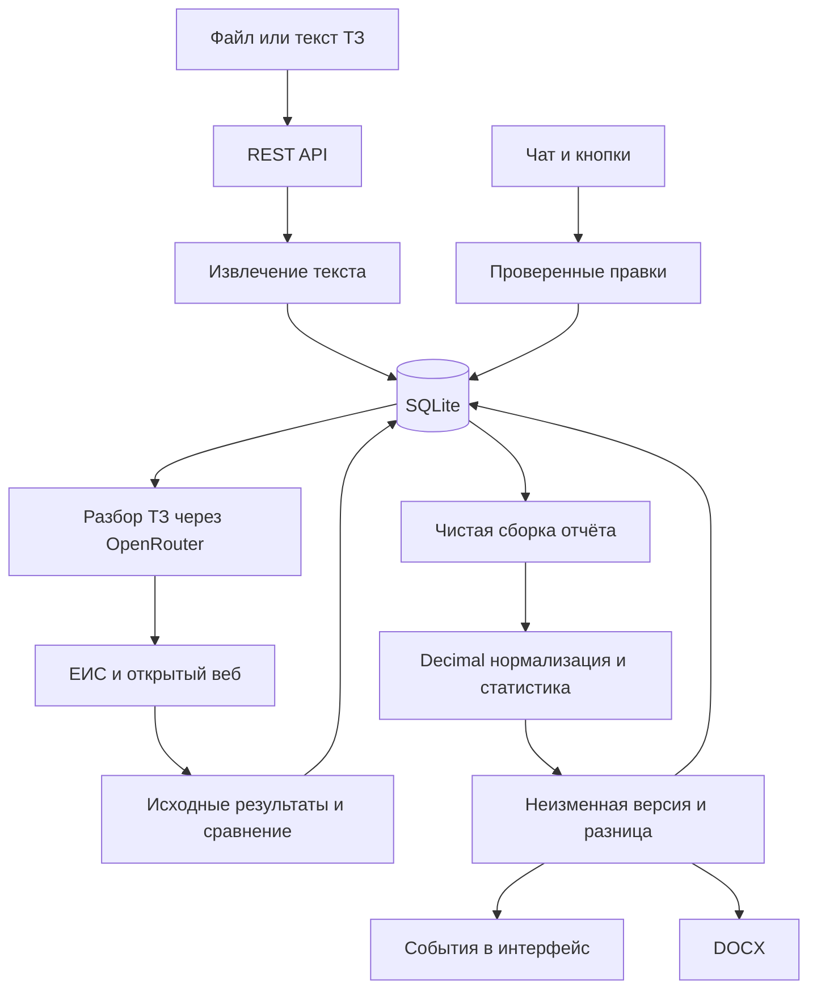

# Архитектура агента НМЦК

Локальное приложение: Python 3.12, FastAPI, Pydantic v2 и SQLite. Один процесс
обслуживает API, очередь чата и поисковые задачи. React/Vite работает отдельно
и использует [API-контракт](api.md).

## Граница LLM и кода

LLM разбирает текст ТЗ и страниц, извлекает цены и условия, сравнивает существенные
характеристики и выбирает инструменты чата. Ответы ограничены схемами и проверяются
кодом. LLM не считает деньги и не пишет произвольные поля отчёта.

Код разбирает `Decimal`, единицы и фасовки, проверяет ссылки, исправления и причины,
считает НДС, ИПЦ, доставку и статистику. Табличные данные ЕИС имеют приоритет
над предположением модели. Повторная сборка по одинаковым входам даёт одинаковый JSON.

## Поисковый каскад

Источники уровня 1 вызываются параллельно для позиции. После приведения цен,
дедупликации, отбора поставщиков и исключения выбросов код проверяет достаточность
и однородность. При нехватке цен либо неоднородности подключается настроенный
уровень 2. В P0 это HTTP и открытый веб, Chromium/Playwright остаются P1.

Позиции исследуются не более чем по три одновременно; у ЕИС отдельное ограничение
конкурентных запросов. Ошибка одного источника становится его статусом и пропуском,
остальные продолжают работу. Неверный ключ OpenRouter прерывает прогон с понятной
ошибкой. При общем отказе источников создаётся отчёт с предупреждениями и без
обоснованной НМЦК, а не с выдуманными ценами.

## Нормализация и расчёт

Цена со страницы за фасовку переводится в базу цены из ТЗ:

`расчётная цена = цена за единицу ТЗ × НДС × ИПЦ + доставка на единицу`.

НДС и доставка разрешаются по данным предложения и политике источника. Неизвестные
данные не заменяются произвольными надбавками. Если старой цене нужны индексы,
а ряда ИПЦ нет или он неполон, отчёт явно показывает ограничение.

После сравнения характеристик и применения правок остаётся одна цена поставщика
(по ИНН, иначе по нормализованному имени). Выбирается более свежая, при равенстве
более низкая цена. Ручной возврат допустимого предложения виден отдельно.
Дубли, несовместимые единицы и выбросы нельзя вернуть принудительно.

Для выборки меньше пяти цен используется допустимое отклонение от медианы;
с пяти цен применяется межквартильный размах. Пороги хранятся в YAML.
По оставшимся ценам считаются среднее, выборочное СКО и коэффициент вариации.
Если цен меньше минимума или CV выше порога, среднее остаётся справочным,
`unit_price` и итог позиции равны `null`.

НМЦК позиции равна средней цене за единицу, умноженной на количество. Общая НМЦК
доступна, когда обоснованы все позиции. Иначе `total=null`, а `total_justified`
содержит сумму по обоснованной части. Фронтенд эти суммы не пересчитывает.

## Правки и версии

SQLite хранит исходные результаты, отдельные правки, базу расчёта и все версии.
Поиск не перезаписывает правку, правка не меняет исходную страницу. Идентификатор
предложения зависит от URL, названия и фасовки, но не от цены.
Пропавшая цель правки остаётся в журнале как неприменённая; при повторном появлении
того же предложения правка действует снова.

Один ход чата фиксирует все свои правки и одну версию атомарно. Поиск перед записью
применяет последние сохранённые правки. Сборка защищена блокировкой закупки,
номер версии и набор данных проверяются транзакцией. Отмена создаёт следующую
версию; прежний отчёт доступен без изменений. Подробности: [хранение и API](backend-api.md).

## Границы P0

Инструмент локальный, без авторизации. Настройки ключа и модели доступны через API;
общие методические конфиги хранятся в постоянном каталоге и меняются валидируемой
атомарной записью YAML. Агент настроек, массовые действия с подтверждением,
локальные настройки, маркетплейсы через браузер и сравнение произвольных версий
относятся к P1. В P0 экспортируется DOCX; PDF-экспорт не реализован.
